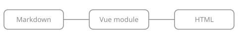

## Callouts

:::note
A note for the reader.
:::

:::warning[Careful]
This can't be undone.
:::

## Code Blocks

```ts title="hello.ts"
export function hello(name: string) {
  return `Hello, ${name}!`; // [!code highlight]
}
```

### Tabs

```ts tab="TypeScript"
const value: number = 1;
```

```js tab="JavaScript"
const value = 1;
```

## Tables

| Syntax     | Result   |
| ---------- | -------- |
| `**bold**` | **bold** |
| `*italic*` | _italic_ |

## Components

Components of the theme are available by name:

<Tabs items={["Vue", "React"]}>
  <Tab value="Vue">Fumapress for Vue renders this page.</Tab>
  <Tab value="React">Fumapress on Waku and Astro use React.</Tab>
</Tabs>

An image that zooms on click:

<ImageZoom src="/diagram.svg" alt="Markdown files become static pages" width="640" height="200" />

An image file next to the page, which the build includes:



<Accordions>
  <Accordion title="Is this component loaded on every page?">
    No. Components only some pages use, like this one, are loaded by the pages that render them.
  </Accordion>
</Accordions>
